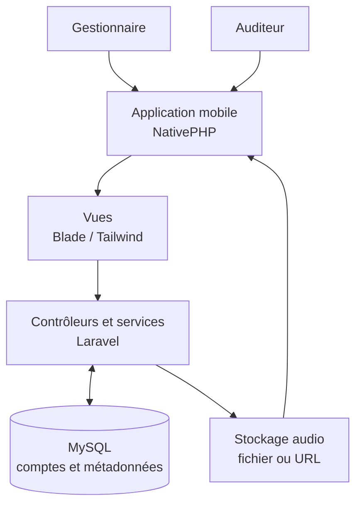

# Architecture du système

## Architecture MVC

Le modèle MVC répartit une application en trois rôles : le modèle représente les données et les règles métier, la vue présente les informations, et le contrôleur coordonne les actions de l'utilisateur avec le modèle.

Pour l'application de gestion de podcasts, les modèles représentent notamment les podcasts, les épisodes, les catégories et les comptes de gestion. Les contrôleurs appliquent les règles de validation et de publication, tandis que les vues présentent le tableau de bord et le catalogue auditeur.

## Architecture en couches

L'architecture cible sépare la présentation mobile, la logique métier et l'accès aux données. Cette séparation facilite l'évolution de l'interface et l'application cohérente des règles de publication.

_Figure — Architecture cible de l'application de gestion de podcasts._

## Responsabilités des couches

- **Présentation** : affiche le catalogue, les fiches podcast, le lecteur et les écrans d'administration.
- **Logique applicative** : valide les données, applique les règles de publication et vérifie les droits d'accès.
- **Persistance** : conserve les comptes et les métadonnées dans la base relationnelle.
- **Stockage audio** : conserve les fichiers audio ou leurs adresses ; les fichiers volumineux ne sont pas stockés comme données binaires dans les tables métier.

Cette architecture est une cible cohérente avec les technologies mentionnées dans le dossier. Le code de l'application n'étant pas présent dans l'espace de travail, son implémentation réelle et les versions utilisées restent à confirmer.
