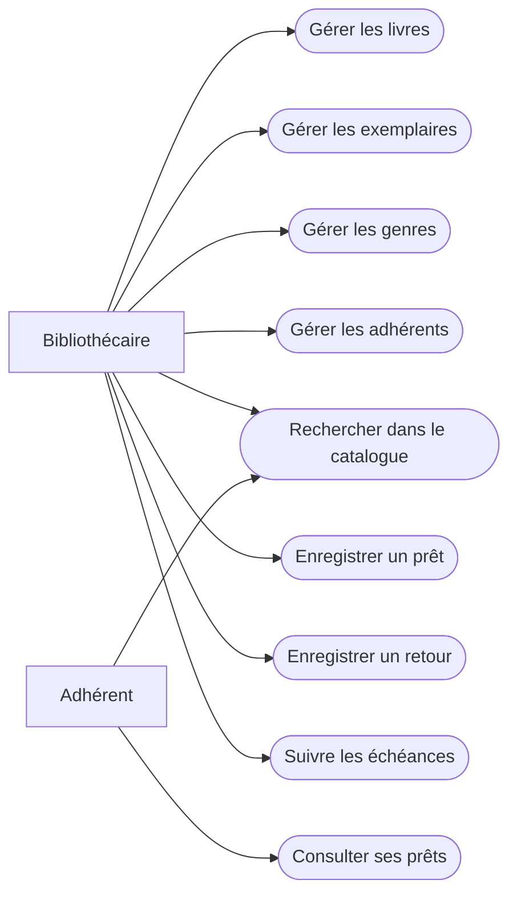
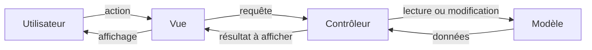
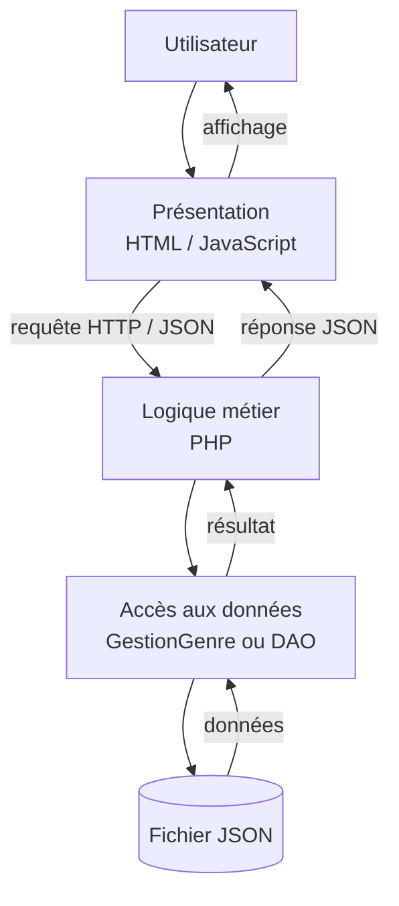
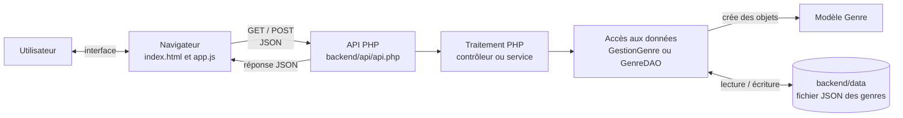
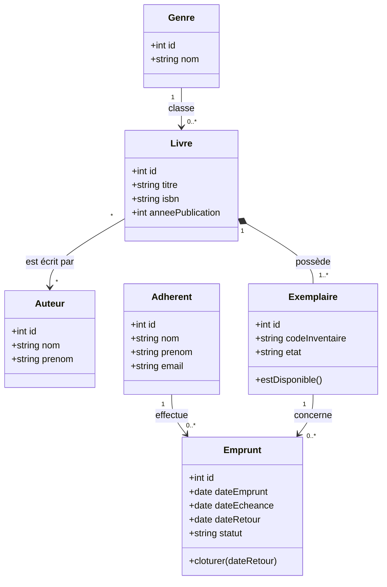

# Rapport

#### Table des matières

- [Remerciements](#remerciements)
- [Introduction](#introduction)
- [Contexte du projet](#contexte-du-projet)
- [Cahier des charges](#cahier-des-charges)
- [Méthodologie de travail](#méthodologie-de-travail)
  - [Méthodologie Scrum](#méthodologie-scrum)
  - [Processus 2TUP](#processus-2tup)
  - [Design Thinking](#design-thinking)
- [Planification](#planification)
- [Branche fonctionnelle](#branche-fonctionnelle)
  - [Carte d'empathie](#carte-dempathie)
  - [Définition du problème](#définition-du-problème)
  - [Idéation](#idéation)
  - [Diagramme de cas d'utilisation](#diagramme-de-cas-dutilisation)
- [Branche technique](#branche-technique)
  - [Stack technologique](#stack-technologique)
  - [Architecture logicielle](#architecture-logicielle)
  - [Prototype (fonctionnalités, classes)](#prototype-fonctionnalités-classes)
- [Conception](#conception)
  - [Diagramme de classes](#diagramme-de-classes)
  - [Maquettes](#maquettes)
- [Réalisation](#réalisation)
  - [Interfaces](#interfaces)
- [Conclusion](#conclusion)

## Remerciements

Nous remercions notre encadrant pour ses conseils et son accompagnement tout au long de ce projet. Nous adressons également nos remerciements aux personnes qui ont partagé leurs retours et contribué à la réflexion autour de l'application de gestion de podcasts.

Enfin, nous remercions les membres de l'équipe pour leur collaboration, leur implication et le travail accompli durant les différentes étapes du projet.

## Introduction

La diffusion de podcasts s'est développée et les auditeurs disposent aujourd'hui d'un grand nombre d'émissions et d'épisodes. Pour les créateurs ou les responsables de contenu, organiser ces ressources, maintenir des informations cohérentes et rendre les épisodes faciles à retrouver représente un défi concret.

Ce projet porte sur la conception d'une application de gestion de podcasts. Elle vise à centraliser les podcasts et leurs épisodes, à gérer leurs informations de publication et à offrir aux auditeurs un moyen simple de parcourir le catalogue et d'écouter les contenus disponibles.

Ce rapport présente le contexte du projet, les besoins des utilisateurs, la démarche de conception, les fonctionnalités attendues, ainsi que l'architecture et le modèle métier proposés. Il distingue les choix de conception de leur implémentation effective, qui devra être vérifiée dans le code de l'application.

## Contexte du projet

#### Présentation

Les créateurs de podcasts doivent organiser leurs émissions et leurs épisodes, conserver des informations fiables sur chaque contenu et préparer leur publication. Lorsque les descriptions, les dates et les liens audio sont dispersés, la mise à jour du catalogue et la recherche d'un épisode deviennent plus difficiles.

Le projet consiste à concevoir une application de gestion de podcasts. Un gestionnaire y administre les podcasts et leurs épisodes, tandis que les auditeurs peuvent découvrir les contenus publiés et lancer leur lecture.

#### Problématique

Comment centraliser et organiser les podcasts et leurs épisodes afin de simplifier leur gestion éditoriale et de permettre aux auditeurs de retrouver rapidement un contenu ?

#### Objectifs

- Centraliser les informations des podcasts et des épisodes.
- Classer les podcasts par catégorie et faciliter leur recherche.
- Gérer les métadonnées d'un épisode, notamment son titre, sa description, sa date et sa ressource audio.
- Distinguer les contenus en préparation des contenus publiés.
- Proposer aux auditeurs un catalogue lisible et un accès direct à la lecture des épisodes publiés.
- Protéger les opérations de gestion par une authentification et des droits adaptés.

#### Acteurs et périmètre

- **Gestionnaire ou créateur** : crée et met à jour les podcasts, organise les épisodes et contrôle leur publication.
- **Auditeur** : parcourt le catalogue, recherche un podcast et écoute un épisode publié.

Le périmètre présenté dans ce rapport décrit la conception cible. Les technologies évoquées dans les notes du dossier sont des choix de référence à confirmer avec le code source de l'application ; aucune fonctionnalité n'est présentée comme livrée sans cette vérification.

## Cahier des charges

#### Besoins fonctionnels

### Gestionnaire

- S'authentifier avant d'accéder aux fonctions d'administration.
- Créer, consulter, modifier et archiver une fiche podcast.
- Créer et gérer les épisodes associés à un podcast.
- Renseigner le titre, la description, la date de publication, la durée et l'adresse de la ressource audio d'un épisode.
- Associer une catégorie à un podcast.
- Enregistrer un épisode comme brouillon, puis le publier ou le dépublier.
- Consulter la liste des contenus et leur état de publication.

### Auditeur

- Parcourir les podcasts publiés et consulter leur description.
- Rechercher un podcast par son titre et filtrer le catalogue par catégorie.
- Consulter la liste des épisodes d'un podcast.
- Lancer la lecture d'un épisode publié et accéder aux informations qui lui sont associées.

#### Règles de gestion

- Un podcast peut contenir plusieurs épisodes ; un épisode appartient à un seul podcast.
- Un podcast appartient à une catégorie, laquelle peut regrouper plusieurs podcasts.
- Un brouillon n'apparaît pas dans le catalogue public.
- Un épisode ne peut être publié que si ses informations obligatoires et sa ressource audio sont valides.
- Les opérations de création, de modification et de suppression sont réservées au gestionnaire autorisé.
- La suppression définitive d'un podcast ayant des épisodes doit être contrôlée ; l'archivage est préférable afin de préserver l'historique.

#### Exigences non fonctionnelles

- L'interface doit être utilisable sur téléphone et ordinateur.
- Les formulaires doivent valider les données et afficher des messages d'erreur compréhensibles.
- Les accès aux fonctions d'administration doivent être protégés.
- Les métadonnées audio doivent être séparées du stockage des fichiers volumineux ; le système conserve une URL ou une référence vers la ressource.
- Les pages de catalogue doivent rester lisibles et permettre une navigation accessible au clavier.

#### Hors périmètre de la première version

La monétisation, la transcription automatique, les recommandations personnalisées, les statistiques avancées et la diffusion en direct ne sont pas incluses dans le périmètre initial.

## Méthodologie de travail

#### Approche adoptée

Le travail est organisé de façon itérative afin de passer progressivement de l'analyse des besoins à la conception, puis à la réalisation et à la vérification de l'application de gestion de podcasts. Le Design Thinking aide à cadrer les usages, 2TUP structure l'analyse fonctionnelle et technique, et Scrum permet de prioriser les tâches en incréments.

La démarche s'appuie sur trois compléments :

- **Design Thinking** pour comprendre les besoins du gestionnaire et des auditeurs avant de concevoir les écrans.
- **2TUP** pour séparer l'étude fonctionnelle du choix et de la conception des solutions techniques.
- **Scrum**, utilisé comme cadre de travail itératif : les tâches sont priorisées, réalisées par étapes et réévaluées à partir des résultats obtenus.

#### Déroulement du travail

1. Identifier les besoins du gestionnaire et des auditeurs et fixer le périmètre initial.
2. Décrire les cas d'utilisation et les règles concernant les podcasts, les épisodes, les catégories et la publication.
3. Élaborer le modèle métier, l'architecture cible et les maquettes des principaux écrans.
4. Réaliser les fonctions prioritaires : administration du catalogue, gestion des épisodes, recherche et lecture.
5. Vérifier les parcours, corriger les défauts et ajuster les priorités à partir des retours.

#### Organisation des tâches

Les besoins sont regroupés dans un backlog et ordonnés selon leur importance pour l'utilisation quotidienne. Une étape de travail comprend la sélection des tâches, leur réalisation, une vérification fonctionnelle et une courte revue des difficultés rencontrées. La durée des itérations et la répartition des rôles sont fixées par l'équipe selon le calendrier du projet.

#### Vérification

Les scénarios essentiels vérifient notamment qu'un brouillon n'est pas visible publiquement, qu'un épisode incomplet ne peut pas être publié et qu'un auditeur peut lancer un épisode publié.

### Méthodologie Scrum

#### Méthode de travail

##### La méthode SCRUM

Scrum organise le travail en itérations courtes et permet de livrer les fonctions prioritaires progressivement. Pour le projet de gestion de podcasts, le backlog regroupe les besoins du gestionnaire et des auditeurs. La durée des sprints et les responsabilités de l'équipe sont à fixer selon le calendrier réel du projet.

*Figure 3 : La méthode SCRUM*

**Principe Scrum :**

- **Transparence** : visibilité complète sur les tâches, les objectifs et l'avancement du projet pour toute l'équipe.
- **Inspection** : évaluation régulière à la fin de chaque sprint afin d'identifier les erreurs, les blocages et les axes d'amélioration.
- **Adaptation** : ajustement du plan de travail en fonction des retours et des résultats obtenus lors des sprints.

**Incrément 1 — Catalogue et administration :**

- Définir les entités Podcast, Épisode et Catégorie.
- Réaliser les opérations d'administration du catalogue et les règles de validation.
- Préparer l'authentification du gestionnaire.

**Incrément 2 — Découverte et lecture :**

- Afficher les podcasts et épisodes publiés.
- Ajouter la recherche et le filtrage par catégorie.
- Permettre l'accès à la ressource audio d'un épisode publié.
- Vérifier les parcours sur téléphone et ordinateur.

Ces incréments constituent une proposition de planification et ne prétendent pas décrire des sprints déjà réalisés.

### Processus 2TUP

##### 2.3 2TUP

###### Définition

La méthode **2TUP** (*Two Tracks Unified Process*) est une démarche itérative qui sépare l'analyse des besoins métier de l'étude des solutions techniques, puis réunit les deux branches dans la conception et la réalisation.

Sa particularité repose sur une architecture en « Y » qui sépare
distinctement deux axes de réflexion :

- **la branche fonctionnelle**, consacrée à la compréhension des utilisateurs,
  des processus et des besoins métier ;
- **la branche technique**, consacrée à l'étude des contraintes techniques,
  à la conception de l'architecture et au choix des technologies.

Pour ce projet, la branche fonctionnelle définit la gestion des podcasts et épisodes, la recherche dans le catalogue et la publication des contenus. La branche technique étudie l'architecture mobile, le modèle des données, la protection des accès et le stockage des ressources audio.

Ces deux branches progressent en parallèle, puis se rejoignent dans une phase
de réalisation. Cette organisation permet de limiter les risques, de vérifier
la cohérence entre les besoins métier et la solution technique, et de faire
évoluer progressivement le produit.

###### Schéma

Le schéma associé au dossier illustre le principe de convergence des deux branches vers la réalisation.

**Figure : Processus 2TUP appliqué à l'application de gestion de podcasts.**

La branche fonctionnelle part de la capture des besoins et aboutit à
l'analyse fonctionnelle. En parallèle, la branche technique part des besoins
techniques et aboutit à la définition de l'architecture et des technologies.
La convergence des deux branches déclenche la phase de réalisation, qui
comprend la conception, le codage, les tests, la recette et le déploiement.

###### Conclusion

La méthode 2TUP fournit un cadre structuré pour la conception de l'application de gestion de podcasts. La séparation entre les branches
fonctionnelle et technique facilite la compréhension des besoins et permet de
prendre les décisions techniques au moment approprié.

En réunissant ces deux branches dans une phase de réalisation progressive,
la méthode favorise la maîtrise des risques, l'amélioration continue et
l'alignement du produit final sur les besoins du gestionnaire et des auditeurs. Elle constitue ainsi une approche pertinente pour les
projets dont les exigences fonctionnelles et les contraintes techniques
doivent être analysées conjointement.

### Design Thinking

Pour ce projet, le Design Thinking aide à comprendre les besoins du gestionnaire de contenu et des auditeurs avant de définir les écrans et les parcours de l'application de gestion de podcasts. Les profils décrits dans la carte d'empathie restent des hypothèses à valider auprès d'utilisateurs réels.

##### Design thinking

Le Design Thinking est une approche de résolution de problèmes centrée sur l’humain. Elle vise à comprendre en profondeur les besoins réels des utilisateurs afin de concevoir des solutions innovantes, utiles et adaptées. Cette méthode est largement utilisée dans les domaines du design, de la technologie, de l’éducation et de l’innovation pour répondre à des problématiques complexes.

  

*Figure : Méthodologie Design Thinking*

Le Design Thinking est particulièrement utilisé pour :

- Encourager la créativité et l’innovation dans la conception de solutions ;
- Proposer des réponses réellement adaptées aux besoins des utilisateurs ;
- Favoriser la collaboration entre différentes équipes de travail ;
- Résoudre des problèmes complexes ou mal définis de manière structurée.

##### Les étapes du Design Thinking

Le processus du Design Thinking se compose de plusieurs étapes essentielles :

- **Empathie (Empathize)** : cette étape consiste à comprendre l’utilisateur en l’observant, en l’interrogeant et en analysant son comportement. L’objectif est d’identifier ses besoins, ses attentes et ses difficultés réelles.
- **Définition du problème (Define)** : elle permet de regrouper les informations collectées afin de formuler un problème clair et centré sur l’utilisateur, souvent exprimé sous forme de question comme : « Comment pourrions-nous améliorer… ? »
- **Idéation (Ideate)** : cette phase consiste à générer un maximum d’idées possibles sans jugement, en utilisant des techniques comme le brainstorming ou le mind mapping afin de stimuler la créativité.
- **Prototype** : elle consiste à créer une version simplifiée de la solution proposée (maquette, interface ou modèle) afin de tester rapidement les idées.
- **Test** : cette dernière étape permet de tester le prototype auprès des utilisateurs, de recueillir leurs retours et d’améliorer la solution en fonction des résultats obtenus.

Le Design Thinking est donc une méthode structurée et flexible qui permet de transformer une idée en solution concrète en mettant toujours l’utilisateur au centre du processus.

## Planification

## Branche fonctionnelle

### Carte d'empathie

### Définition du problème

### Idéation

### Diagramme de cas d'utilisation

##### Acteurs et fonctionnalités

Le bibliothécaire est responsable des opérations de gestion. L'adhérent consulte le catalogue et peut consulter ses propres prêts lorsque cette fonction est incluse dans l'application.

_Figure — Cas d'utilisation cible du système de gestion de bibliothèque._

##### Règles principales

- Un prêt concerne un adhérent et un exemplaire précis.
- Un exemplaire ne peut avoir qu'un seul prêt en cours à la fois.
- Un retour clôt le prêt en enregistrant la date effective de retour.
- La disponibilité est calculée à partir de l'état des exemplaires et des prêts en cours.
- La recherche dans le catalogue ne modifie pas les données.

##### Limite d'interprétation

Ce diagramme représente le périmètre fonctionnel cible. Le prototype technique décrit dans les documents disponibles ne démontre actuellement que la gestion des genres ; les autres cas doivent être vérifiés ou développés dans l'application.

## Branche technique

Dans cette section, nous présentons la branche technique de notre projet, qui consiste à décrire les choix technologiques, les outils et les architectures adoptés pour assurer le bon fonctionnement de l'application, tout en garantissant une solution performante, sécurisée et adaptée aux besoins identifiés.

---

#### Choix technologiques

Dans le cadre de ce projet, plusieurs technologies modernes et complémentaires ont été sélectionnées pour garantir la performance, la maintenabilité, la sécurité et la rapidité de la plateforme de gestion de copropriété immobilière.

### Technologies Backend

- **PHP 8.2+ et Laravel 12.0** : Ce duo technologique est utilisé pour développer le backend en architecture MVC, garantissant une base sécurisée, des performances accrues et un code structuré.
- **Spatie Laravel Permission 7.4** : Bibliothèque pour la gestion professionnelle des rôles et des autorisations, garantissant un cloisonnement strict des accès.
- **NativePHP** : Framework pour transformer l'application Laravel en application mobile (Android, iOS) pour les résidents.

### Technologies Frontend

- **Blade Templates** : Moteur de rendu HTML, natif de Laravel, utilisé pour structurer l'interface utilisateur en composants réutilisables.
- **Tailwind CSS** : Framework CSS utilitaire ultra-rapide, permettant de concevoir une interface sur mesure, moderne, responsive et compatible mode sombre.
- **Alpine** : Framework JavaScript léger et réactif, utilisé pour les animations du frontend (barres de recherche, modales, menus déroulants).
- **Preline** : Bibliothèque de composants UI basés sur Tailwind CSS, accélérant le développement avec des modèles prêts à l'emploi.
- **Vite** : Outil de build moderne, optimisant la compilation des ressources CSS/JS pour un chargement de page ultra-rapide en production.

### Base de données

- **MySQL** : Système de gestion de base de données relationnelle (SGBDR) fiable, utilisé pour stocker l'intégralité des données de l'application.

### Outils et utilitaires externes

- **Mermaid** : Outil permettant de générer des schémas et diagrammes à partir d'une syntaxe textuelle simple.
- **PlantUML** : Solution utilisée pour concevoir les différents diagrammes UML nécessaires à l'analyse et à la documentation du système.

### Stack technologique

Dans cette section, nous présentons la branche technique de notre projet, qui consiste à décrire les choix technologiques, les outils et les architectures adoptés pour assurer le bon fonctionnement de l'application, tout en garantissant une solution performante, sécurisée et adaptée aux besoins identifiés.

---

##### Choix technologiques

Dans le cadre de ce projet, plusieurs technologies modernes et complémentaires ont été sélectionnées pour garantir la performance, la maintenabilité, la sécurité et la rapidité de la plateforme de gestion de copropriété immobilière.

###### Technologies Backend

- **PHP 8.2+ et Laravel 12.0** : Ce duo technologique est utilisé pour développer le backend en architecture MVC, garantissant une base sécurisée, des performances accrues et un code structuré.
- **Spatie Laravel Permission 7.4** : Bibliothèque pour la gestion professionnelle des rôles et des autorisations, garantissant un cloisonnement strict des accès.
- **NativePHP** : Framework pour transformer l'application Laravel en application mobile (Android, iOS) pour les résidents.

###### Technologies Frontend

- **Blade Templates** : Moteur de rendu HTML, natif de Laravel, utilisé pour structurer l'interface utilisateur en composants réutilisables.
- **Tailwind CSS** : Framework CSS utilitaire ultra-rapide, permettant de concevoir une interface sur mesure, moderne, responsive et compatible mode sombre.
- **Alpine** : Framework JavaScript léger et réactif, utilisé pour les animations du frontend (barres de recherche, modales, menus déroulants).
- **Preline** : Bibliothèque de composants UI basés sur Tailwind CSS, accélérant le développement avec des modèles prêts à l'emploi.
- **Vite** : Outil de build moderne, optimisant la compilation des ressources CSS/JS pour un chargement de page ultra-rapide en production.

###### Base de données

- **MySQL** : Système de gestion de base de données relationnelle (SGBDR) fiable, utilisé pour stocker l'intégralité des données de l'application.

###### Outils et utilitaires externes

- **Mermaid** : Outil permettant de générer des schémas et diagrammes à partir d'une syntaxe textuelle simple.
- **PlantUML** : Solution utilisée pour concevoir les différents diagrammes UML nécessaires à l'analyse et à la documentation du système.

### Architecture logicielle

#### Architecture du système

##### Architecture MVC

Le modèle MVC répartit une application en trois rôles :

- **Modèle** : représente les données et les règles qui leur sont liées.
- **Vue** : affiche les informations et reçoit les actions de l’utilisateur.
- **Contrôleur** : reçoit une action, sollicite le modèle et transmet le résultat à la vue.

_Figure 1 — Échange MVC : le contrôleur coordonne la vue et le modèle lors d’une requête._

Dans le projet, MVC sert de **repère de compréhension**, mais n’est pas appliqué strictement : l’interface HTML/JavaScript est côté navigateur, tandis que le point d’entrée PHP et les classes de traitement jouent les rôles de coordination. La classe `Genre` représente les données métier.

##### Architecture 3-tiers

Cette architecture sépare l’application en couches qui communiquent de proche en proche :

- **Présentation** : interface HTML/JavaScript ; envoie les requêtes et affiche les réponses.
- **Logique métier** : traite les opérations demandées par l’utilisateur.
- **Accès aux données** : lit et écrit les données dans leur support de stockage.

_Figure 2 — Les trois tiers séparent l’interface, le traitement des opérations et le stockage._

##### Architecture globale

Le projet permet de consulter et d’ajouter des genres. L’interface du navigateur communique avec une API PHP via `fetch`. Les données sont conservées dans un fichier JSON ; elles ne sont pas stockées dans une base de données relationnelle.

_Figure 3 — Architecture commune aux versions du projet ; les noms des classes varient selon la version._

Le parcours d’une requête est le suivant :

1. `app.js` envoie une requête **GET** pour afficher les genres ou **POST** pour en ajouter un.
2. `api.php` transmet l’opération au traitement PHP, puis à la classe qui lit ou met à jour le fichier JSON.
3. Le résultat est renvoyé au navigateur au format JSON ; l’interface affiche la liste actualisée.

##### Évolution vers la gestion de bibliothèque

L’architecture décrite ci-dessus correspond au prototype technique actuellement documenté, dont les opérations portent sur les genres. Pour couvrir le système cible de gestion de bibliothèque, la même séparation en trois tiers peut être conservée, en ajoutant les traitements métier et les données de livres, d’exemplaires, d’auteurs, d’adhérents et d’emprunts. Les diagrammes fonctionnels et métier de ce rapport présentent cette cible ; ils ne signifient pas que ces fonctionnalités sont déjà présentes dans le prototype.

### Prototype (fonctionnalités, classes)

## Conception

### Diagramme de classes

##### Modèle métier cible

Le modèle distingue le livre décrit dans le catalogue de ses exemplaires physiques. Cette séparation permet de suivre plusieurs copies d'un même titre et de connaître la disponibilité de chacune.

_Figure — Modèle métier cible du système de gestion de bibliothèque._

##### Responsabilités des classes

- **Livre** décrit un titre du catalogue. Un livre peut être associé à plusieurs auteurs et à un genre.
- **Exemplaire** représente une copie identifiable et suivie séparément. Son état permet de distinguer, par exemple, une copie disponible d'une copie détériorée.
- **Adherent** contient les informations nécessaires à l'identification d'un usager de la bibliothèque.
- **Emprunt** relie un adhérent à un exemplaire et conserve les dates ainsi que l'état de l'opération.
- **Auteur** et **Genre** facilitent le classement et la recherche du catalogue.

##### Contraintes de gestion

Un emprunt actif rend l'exemplaire indisponible. La date de retour reste vide tant que l'exemplaire n'a pas été rendu. Les règles de validation doivent vérifier qu'un exemplaire est disponible avant la création d'un prêt et qu'un retour ne clôture pas deux fois le même emprunt.

Ce diagramme décrit le modèle cible. Les documents techniques actuels ne confirment que la présence d'un modèle `Genre` dans le prototype ; les autres classes sont à réaliser ou à valider dans le code.

### Maquettes

## Réalisation

### Interfaces

## Conclusion
